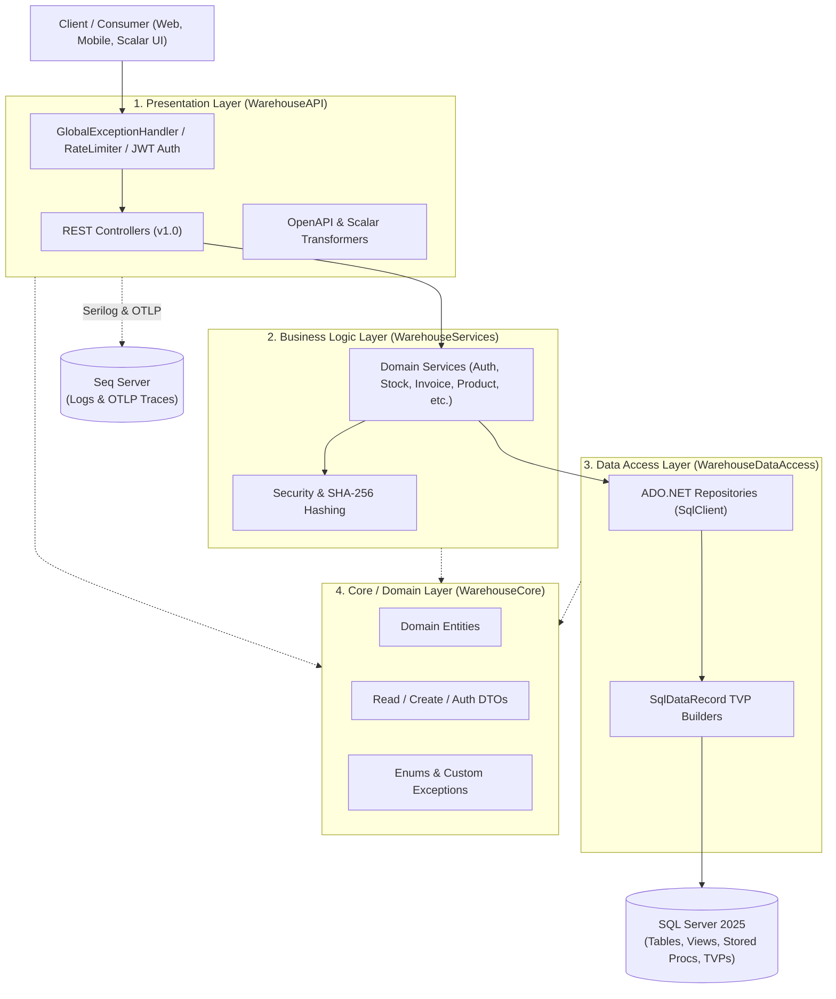

<div align="center">

# 📦 Warehouse Management System API

**An Enterprise-Grade, High-Performance RESTful API for Multi-Warehouse Inventory, Procurement, Sales Invoicing, and Stock Ledger Management**

[](https://dotnet.microsoft.com/)
[](https://learn.microsoft.com/en-us/dotnet/csharp/)
[](https://www.microsoft.com/en-us/sql-server)
[](https://www.docker.com/)
[](https://opentelemetry.io/)
[](https://scalar.com/)
[](https://opensource.org/licenses/MIT)

</div>

---

## 📖 Overview

The **Warehouse Management System (WMS) API** is a modern, production-ready backend solution built with **ASP.NET Core (.NET 10.0)** and **SQL Server**. It is designed to solve the complex challenges of tracking inventory across multiple physical locations, managing procurement and sales workflows, preventing stock discrepancies, and maintaining an immutable audit trail of every inventory movement.

Instead of relying on heavy ORM abstractions for complex transactional workflows, this system leverages **high-performance ADO.NET (`Microsoft.Data.SqlClient`)** combined with **SQL Server Stored Procedures, Views, and Table-Valued Parameters (TVPs)**. This hybrid approach guarantees atomic multi-item invoice approvals and stock transfers with minimal latency and maximum database throughput.

---

## ✨ Key Features

* 🔐 **JWT Authentication & Refresh Token Rotation**
  * Stateless authentication using `HMAC-SHA256` signed JSON Web Tokens (JWT).
  * Secure refresh token mechanism (`/api/token/generate` & `/api/token/refresh`) with configurable expiration windows and `SHA-256` password hashing.
* 🛡️ **Fine-Grained Role-Based Access Control (RBAC)**
  * Pre-configured authorization policies tailored to real-world organizational roles:
    * `System Administrator` — Full system & user management access.
    * `Warehouse Manager` — Manages warehouses, stock transfers, and inventory ledgers.
    * `Purchasing Officer` — Manages suppliers, products, and purchase invoices.
    * `Sales Representative` — Manages customers and sales invoices.
    * `Accountant` — Audits invoices, updates invoice statuses, and inspects stock valuations & ledgers.
* 🏭 **Multi-Warehouse & Real-Time Stock Management**
  * Track stock balances, unit costs, and total inventory valuation per product across one or all warehouses (`vw_CurrentStock`).
  * Execute atomic inter-warehouse **Stock Transfers** (`sp_ExecuteStockTransfer`) with status lifecycle tracking (`Pending`, `Completed`, `Cancelled`).
  * Comprehensive **Item Ledger** (`vw_ItemLedger`) providing a chronological audit trail of all inbound and outbound inventory transactions.
* 🧾 **Sales & Purchase Invoicing with Bulk TVPs**
  * Create multi-line **Sales Invoices** (`sp_ApproveSalesInvoice`) and **Purchase Invoices** (`sp_ApprovePurchaseInvoice`) in a single database round-trip using SQL Server **Table-Valued Parameters (`SqlDbType.Structured`)**.
  * Query paginated invoice summaries by Customer, Supplier, or across the entire organization (`vw_InvoicesSummary`).
* 🗑️ **Seamless Soft Deletion via `INSTEAD OF` Triggers**
  * Prevents accidental data loss and maintains historical audit trails for critical domain entities.
  * Leverages SQL Server `INSTEAD OF DELETE` triggers to transparently intercept database `DELETE` commands and convert them into logical updates (e.g., `SET IsActive = 0`). This keeps the Data Access Layer cleanly decoupled and unaware of the underlying soft-delete mechanism.
* 🌐 **Rich RESTful Semantics (`GET`, `POST`, `PUT`, `DELETE`, `HEAD`, `OPTIONS`)**
  * Dedicated `HEAD` endpoints for ultra-fast, payload-free existence checks (by ID, Username, Email, Phone, SKU, Barcode, Warehouse Code, and Tax Number).
  * `OPTIONS` endpoints on every resource for capability discovery.
  * Standardized `PagedResult<T>` wrapper with metadata (`TotalCount`, `TotalPages`, `HasNextPage`, `HasPreviousPage`).
* 🚦 **Multi-Tier Rate Limiting & Abuse Protection**
  * **General Policy (`SlidingWindow`)**: 100 requests / minute per IP address.
  * **Login Policy (`FixedWindow`)**: 5 attempts / minute per IP address to prevent brute-force attacks.
  * **Refresh Policy (`TokenBucket`)**: 10 token capacity with replenish rate of 5 tokens / minute per authenticated user or IP.
* 📊 **Enterprise Observability (Serilog + Seq + OpenTelemetry)**
  * Structured request and domain logging via **Serilog**, enriched with machine name, thread ID, and log context.
  * Distributed tracing via **OpenTelemetry** (`AspNetCore` & `HttpClient` instrumentation) exported over OTLP to **Seq**.
* ⚠️ **Standardized Global Exception Handling (RFC 7807)**
  * Centralized `GlobalExceptionHandler` implementing `IExceptionHandler` that maps domain exceptions (`NotFoundException`, `ConflictException`, `BadRequestException`, `UnauthorizedException`) and SQL errors into standardized **RFC 7807 `ProblemDetails`** responses.
* 📚 **Interactive API Documentation & Versioning**
  * Header-based API versioning (`api-version: 1.0`).
  * Native .NET 10 OpenAPI specification with custom document/operation transformers and an interactive **Scalar API Reference UI**.

---

## 🛠️ Tech Stack & Libraries

| Category | Technology / Package | Version | Purpose |
| :--- | :--- | :--- | :--- |
| **Framework** | `.NET SDK / ASP.NET Core` | `10.0` | Core web framework & runtime |
| **Language** | `C#` | `14.0` | Primary programming language |
| **Database** | `Microsoft SQL Server` | `2025-latest` | Relational database engine, Stored Procedures, Views & TVPs |
| **Data Access** | `Microsoft.Data.SqlClient` | `7.0.1` | High-performance ADO.NET database connectivity |
| **Authentication** | `Microsoft.AspNetCore.Authentication.JwtBearer` | `10.0.7` | JWT Bearer token validation & authentication |
| **API Versioning** | `Asp.Versioning.Mvc` & `ApiExplorer` | `10.0.0` | Header-based API versioning & route discovery |
| **API Docs** | `Microsoft.AspNetCore.OpenApi` & `Scalar.AspNetCore` | `10.0.7` / `2.14.11` | OpenAPI v1 specification generation & Scalar interactive UI |
| **Caching** | `Microsoft.Extensions.Caching.StackExchangeRedis` & `MemoryCache` | `10.0.7` | In-memory & distributed caching support |
| **Logging** | `Serilog.AspNetCore` & `Serilog.Sinks.Seq` | `10.0.0` / `9.0.0` | Structured logging to Console and Seq |
| **Tracing** | `OpenTelemetry.Extensions.Hosting` & `Exporter.Otlp` | `1.15.3` | Distributed tracing for HTTP & ASP.NET Core requests |
| **Containerization** | `Docker` & `Docker Compose` | Latest | Multi-container orchestration (API, SQL Server, Seq) |

---

## 🏗️ Architecture & Project Structure

The solution follows a clean, decoupled **4-Layer N-Tier Architecture** enforcing strict separation of concerns:



### 📂 Directory Tree

```text
WarehouseManagement/
├── WarehouseManagement.slnx                 # .NET XML Solution file
├── docker-compose.yml                       # Multi-container setup (API, SQL Server 2025, Seq)
│
├── WarehouseAPI/                            # 🌐 Presentation & Host Layer
│   ├── Controllers/                         # REST API Endpoints
│   │   ├── TokenController.cs               # POST /api/token/generate, /api/token/refresh
│   │   ├── UserController.cs                # CRUD & HEAD/OPTIONS for Users
│   │   ├── WarehouseController.cs           # CRUD & HEAD/OPTIONS for Warehouses
│   │   ├── ProductController.cs             # CRUD & HEAD/OPTIONS for Products (ID, SKU, Barcode)
│   │   ├── CustomerController.cs            # CRUD & HEAD/OPTIONS for Customers
│   │   ├── SupplierController.cs            # CRUD & HEAD/OPTIONS for Suppliers
│   │   ├── InvoiceController.cs             # Sales & Purchase Invoices, Summaries, Status Updates
│   │   └── StockController.cs               # Stock Transfers, Warehouse Stock, Item Ledger
│   ├── Helpers/
│   │   └── PagedResult.cs                   # Generic pagination response wrapper
│   ├── OpenApi/                             # OpenAPI document & JWT security scheme transformers
│   ├── Services/
│   │   └── GlobalExceptionHandler.cs        # Centralized RFC 7807 ProblemDetails exception handler
│   ├── DependencyInjection.cs               # Clean service registration extensions
│   ├── Program.cs                           # Application bootstrapper & middleware pipeline
│   ├── Dockerfile                           # Multi-stage Docker build for .NET 10.0
│   └── appsettings.json                     # Serilog, JWT, and OpenTelemetry configuration
│
├── WarehouseServices/                       # 🧠 Business Logic Layer
│   ├── Interfaces/                          # Service contracts (IStockService, IInvoiceService, etc.)
│   ├── Services/                            # Business rules, validations, and orchestration
│   └── Security/
│       └── Hashing.cs                       # SHA-256 password hashing & verification
│
├── WarehouseDataAccess/                     # 🗄️ Data Access Layer
│   ├── Interfaces/                          # Repository contracts (IStockRepository, etc.)
│   └── Repositories/                        # ADO.NET implementations, TVP mappers & SQL queries
│
└── WarehouseCore/                           # 📦 Core Domain Layer (Zero External Dependencies)
    ├── Entities/                            # Domain models (Invoice, Product, StockTransfer, etc.)
    ├── DTOs/                                # Data Transfer Objects (AuthDTOs, CreateDTOs, ReadDTOs)
    ├── Exceptions/                          # Custom domain exceptions (NotFound, Conflict, BadRequest)
    ├── CustomTypes/                         # TVP structure definitions (InvoiceItemType, TransferItemType)
    └── enums/                               # Domain enumerations (enRole, enInvoiceStatus, enUnit, etc.)
```

---

## 🚀 Getting Started

### 1. Prerequisites

Ensure you have the following tools installed on your machine:

* **[.NET 10.0 SDK](https://dotnet.microsoft.com/download/dotnet/10.0)** (`10.0.100` or later)
* **[Docker Desktop](https://www.docker.com/products/docker-desktop/)** (for running SQL Server 2025 & Seq via Docker Compose)
* **[SQL Server](https://www.microsoft.com/en-us/sql-server/sql-server-downloads)** (Local instance or Docker container)
* **Git**

---

### 2. Installation & Configuration

1. **Clone the repository:**
   ```bash
   git clone https://github.com/your-username/WarehouseManagement.git
   cd WarehouseManagement
   ```

2. **Restore NuGet dependencies:**
   ```bash
   dotnet restore WarehouseManagement.slnx
   ```

3. **Configure Environment Variables / User Secrets:**

   #### Option A: Using `.env` (for Docker Compose)
   Create a `.env` file in the root directory next to `docker-compose.yml`:
   ```env
   DB_SA_PASSWORD=YourStrong@Passw0rd!
   SEQ_PASSWORD=YourSeqAdminPassword!
   DB_CONNECTION=Server=warehousesqlserver,1433;Database=WarehouseDB;User Id=sa;Password=YourStrong@Passw0rd!;TrustServerCertificate=True;
   JWT_KEY=YourSuperSecretJwtSigningKeyWithAtLeast32BytesLength!
   Certificates_Password=YourDevCertPassword
   ```

   #### Option B: Using .NET User Secrets (for Local Development)
   Initialize and set user secrets for the `WarehouseAPI` project:
   ```bash
   cd WarehouseAPI
   dotnet user-secrets set "ConnectionStrings:DefaultConnection" "Server=localhost,1434;Database=WarehouseDB;User Id=sa;Password=YourStrong@Passw0rd!;TrustServerCertificate=True;"
   dotnet user-secrets set "Jwt:Key" "YourSuperSecretJwtSigningKeyWithAtLeast32BytesLength!"
   ```

---

### 3. Database Setup

Because this project uses **raw ADO.NET with SQL Server Stored Procedures, Views, and User-Defined Table Types (TVPs)** for maximum performance, ensure your SQL Server database (`WarehouseDB`) is provisioned with the required schema objects before running the API:

* **Tables**: `Users`, `Warehouses`, `Categories`, `Products`, `Customers`, `Suppliers`, `Invoices`, `SalesInvoices`, `PurchaseInvoices`, `InvoiceItems`, `StockBalances`, `StockTransfers`, `StockTransferItems`, `InventoryTransactions`
* **User-Defined Table Types (TVPs)**:
  * `dbo.InvoiceItemType` (`ProductID INT`, `Quantity DECIMAL(18,2)`, `UnitPrice DECIMAL(18,2)`, `DiscountAmount DECIMAL(18,2)`, `TaxAmount DECIMAL(18,2)`)
  * `dbo.TransferItemType` (`ProductID INT`, `Quantity DECIMAL(18,2)`)
* **Views**:
  * `vw_CurrentStock`
  * `vw_ItemLedger`
  * `vw_InvoicesSummary`
* **Stored Procedures**:
  * `sp_ApprovePurchaseInvoice`
  * `sp_ApproveSalesInvoice`
  * `sp_ExecuteStockTransfer`

---

### 4. Running the Application

#### 🐳 Method 1: Run Everything with Docker Compose (Recommended)

Generate a local HTTPS development certificate (if running for the first time) and launch the full stack (`warehouseapi`, `warehousesqlserver`, and `warehouseapi.seq`):

```bash
dotnet dev-certs https -ep ${HOME}/.aspnet/https/warehouseapi.pfx -p YourDevCertPassword
dotnet dev-certs https --trust

docker compose up --build -d
```

* **Warehouse API (HTTPS)**: `https://localhost:8081`
* **SQL Server 2025**: `localhost,1434`
* **Seq Dashboard (Logs & Traces)**: `http://localhost:5342`

#### 💻 Method 2: Run Locally via .NET CLI

```bash
dotnet run --project WarehouseAPI/WarehouseAPI.csproj --launch-profile https
```

Or run with hot-reload enabled during development:

```bash
dotnet watch --project WarehouseAPI/WarehouseAPI.csproj
```

* **Local API Base URL**: `https://localhost:7036`

---

### 5. Building & Testing

To verify the solution compiles cleanly across all layers:

```bash
dotnet build WarehouseManagement.slnx --configuration Release
```

To execute unit/integration tests (when a test project is added to the solution):

```bash
dotnet test WarehouseManagement.slnx
```

---

## 📚 API Documentation & Endpoints

In the **Development** environment, the API automatically exposes an OpenAPI v1 specification and the interactive **Scalar API Reference** portal.

| Resource | Local CLI URL | Docker Compose URL |
| :--- | :--- | :--- |
| **Scalar Interactive UI** | [`https://localhost:7036/scalar/v1`](https://localhost:7036/scalar/v1) | [`https://localhost:8081/scalar/v1`](https://localhost:8081/scalar/v1) |
| **OpenAPI JSON Spec** | [`https://localhost:7036/openapi/v1.json`](https://localhost:7036/openapi/v1.json) | [`https://localhost:8081/openapi/v1.json`](https://localhost:8081/openapi/v1.json) |
| **Seq Observability UI** | `http://localhost:5342` | `http://localhost:5342` |

### 🔑 Authenticating in Scalar UI
1. Open the Scalar UI at `/scalar/v1`.
2. Navigate to **`POST /api/token/generate`** under the **Authentication** tag and execute a login request with valid credentials.
3. Copy the returned `accessToken`.
4. Paste the token into the **Bearer Auth** input at the top of the Scalar interface to unlock protected endpoints.
5. *(Optional)* Pass the `api-version: 1.0` header in requests (defaults to `1.0` when omitted).

### 🗺️ API Endpoint Summary

| Controller / Tag | Base Route | Key Operations | Authorized Roles |
| :--- | :--- | :--- | :--- |
| **Authentication** | `/api/token` | `POST /generate`, `POST /refresh` | `Anonymous` (Rate Limited) |
| **Users** | `/api/Users` | Full CRUD, Paged List, `HEAD` by ID/Username/Email, `OPTIONS` | `System Administrator` |
| **Warehouses** | `/api/warehouses` | Full CRUD, Paged List, `HEAD` by ID/Name/Code, `OPTIONS` | Read: All Roles · Write: `Admin`, `Warehouse Manager` |
| **Products** | `/api/products` | Full CRUD, Paged List, `HEAD` by ID/SKU/Barcode, `OPTIONS` | Read: All Roles · Write: `Admin`, `Purchasing Officer`, `Warehouse Manager` |
| **Customers** | `/api/customers` | Full CRUD, Paged List, `HEAD` by ID/Email/Phone, `OPTIONS` | Read: `Admin`, `Sales`, `Warehouse Mgr`, `Accountant` · Write: `Admin`, `Sales` |
| **Suppliers** | `/api/suppliers` | Full CRUD, Paged List, `HEAD` by ID/Email/Phone/TaxNumber, `OPTIONS` | Read: `Admin`, `Purchasing`, `Warehouse Mgr`, `Accountant` · Write: `Admin`, `Purchasing` |
| **Invoices** | `/api/invoices` | Create Sales/Purchase Invoices, Update Status, Customer/Supplier/Global Summaries | Role-specific per operation (`Admin`, `Sales`, `Purchasing`, `Accountant`, `Warehouse Mgr`) |
| **Stocks** | `/api/stocks` | Create Transfer, Update Transfer Status, Product/Warehouse Stock, Item Ledger | Transfers: `Admin`, `Warehouse Mgr` · Ledger: `Admin`, `Accountant`, `Warehouse Mgr` · Stock Queries: All Roles |

---

## 📄 License

This project is licensed under the **MIT License** — see the `LICENSE` file for details.

---

## 📬 Contact & Support

Have questions, suggestions, or need support? Feel free to reach out!

- **Developer**: Nizar Omar
- **GitHub**: [NizarCvC](https://github.com/NizarCvC)
- **Email**: [nizar78787@icloud.com](mailto:nizar78787@icloud.com)
- **LinkedIn**: [Your LinkedIn Profile](https://www.linkedin.com/in/nizar-omar7)

<div align="center">

**If you found this project useful, please consider giving it a ⭐ on GitHub!**

</div>
